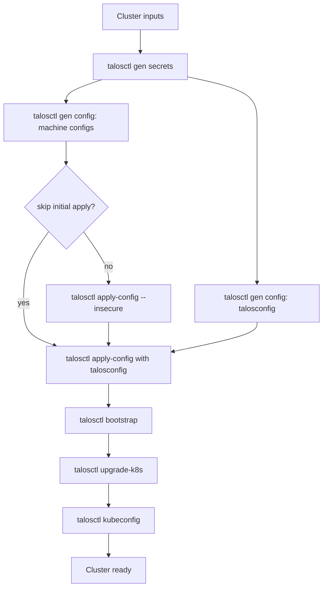

# pulumi-talos-cluster (WIP)

`pulumi-talos-cluster` is a Pulumi component designed to simplify the creation and management of Talos clusters. This component abstracts the complexities of setting up and managing Talos-based Kubernetes clusters, allowing for streamlined deployment and configuration.

This component can be used for bare-metal and cloud installations. Direct access to `apid` on nodes is required.

*Note: This project is in active development, and not all features are complete.*

## Requirements

Only Linux is supported as the runner operating system. The following tools must be available:

- `bash` (must be available at `/bin/bash`)
- `printf`
- `talosctl` (version `v1.12.0` or compatible recommended to match the default Talos image version)

## Quick Start

1. Install `bash` (at `/bin/bash`), `printf`, and `talosctl` on a Linux machine.
2. Clone this repository.
3. Run an example program, such as those under `integration-tests/testdata`, using `pulumi up`. The provider plugin installs automatically.

Existing stacks that use the Pulumiverse Talos provider must follow the [migration guide](specs/001-drop-pulumiverse/contracts/migration-guide.md) before applying this version.

Generated machine configurations, client credentials, talosconfig, and kubeconfig are Pulumi secret outputs. Use `pulumi stack output --show-secrets <name>` only in a controlled environment.

## Cluster Lifecycle



The Pulumi command provider executes each CLI operation. Temporary credentials are written with restrictive permissions, sensitive stdout is suppressed, and working directories are removed after execution.

## Talos Image Upgrades

Changing a machine's `talosImage` upgrades the node to that image: `talosctl upgrade` uses the machine's `talosImage` directly and the following `apply-config` sets `machine.install.image` to the same value. (Up to 0.4.1, the upgrade read the install image from a stale generated configuration, so image changes were not applied.)

`Apply` accepts an optional `machineTopology` input (plain machine IDs grouped by type). Pass `Cluster.machineTopology` so that per-node resources can be planned before `applyMachines` is known. When it is omitted, as in programs written for 0.4.1, the topology is derived from `applyMachines`, which keeps the 0.4.1 behaviour.

The CLI stages update in place when their inputs change. They do not use `triggers`, because pulumi-command replaces a command on any trigger change, and a replacement re-runs its create command. Each stage re-runs only when an input it actually uses changes:

- `cli-upgrade`: the image is part of the `talosctl upgrade --image` command, so changing `talosImage` re-runs the upgrade.
- `cli-apply-config`: the environment carries a hash of the rendered `machineconfig.yaml`, so the command re-runs only when the rendered config changes (for example, after a change to the config patches, the cluster endpoint or `talosImage`).
- `cli-upgrade-k8s`: the Kubernetes version is part of the command.

The commands run `talosctl` directly, without extra checks against the node.

### First `pulumi up` after upgrading from 0.4.1 or 0.5.x

Stacks deployed with 0.4.1, 0.5.0 or 0.5.1 store `triggers` on `cli-upgrade`, `cli-apply-config` and `cli-upgrade-k8s`. Dropping them replaces these commands once, and the replacement runs `talosctl upgrade` (a reboot per node, control planes one after another behind the etcd health check), `apply-config` and `upgrade-k8s`. To avoid this, remove `triggers` from those resources in the stack state (`pulumi stack export`, edit, `pulumi stack import`) before the first `pulumi up`, and check that `pulumi preview` shows no replacements.

## Motivation

The official Terraform (and therefore Pulumi) provider for Talos has certain limitations, particularly around upgrading and configuring clusters, as highlighted in issues like [#195](https://github.com/siderolabs/terraform-provider-talos/issues/195). This component directly orchestrates `talosctl` and utilizes the `pulumi/command` provider to fully manage Talos clusters, overcoming these limitations and providing a more native experience.

## Development
### Go
*Note: It is recommended to use Pulumi's local storage for development, as using the Pulumi service or self-hosted S3 storage can slow down deployments.*

To build the component:
```
$ make build && make install_provider # This generates all SDKs and builds the provider
$ export PATH=$PATH:~/go/bin
```

### Preparing for release
Run these commands in the release branch's local checkout. The worker needs Go, a Pulumi CLI matching `.pulumi.version`, Node.js and Yarn, .NET, Python 3 with `venv`, and Make on its `PATH`. On Linux x86_64, install a missing Pulumi CLI outside the checkout with:

```bash
PULUMI_TOOLS=$(mktemp -d)
curl -fsSL "https://get.pulumi.com/releases/sdk/pulumi-v$(cat .pulumi.version)-linux-x64.tar.gz" -o "$PULUMI_TOOLS/pulumi.tar.gz"
tar -xzf "$PULUMI_TOOLS/pulumi.tar.gz" -C "$PULUMI_TOOLS"
export PATH="$PULUMI_TOOLS/pulumi:$PATH"
```

The `pulumi-deployer` MCP may report its Pulumi or `pulumictl` version, but its working directory is separate from this checkout; it cannot write the SDKs here. An explicit `VERSION` makes `pulumictl` unnecessary for the build.

```bash
export VERSION=v0.5.1 # Replace with the intended release tag.
make generate_schema
make generate # Includes the Go SDK.
make build    # Builds the provider, .NET, Node.js, and Python SDKs.

node -e 'const v = require("./sdk/nodejs/bin/package.json").version; if (v !== process.env.VERSION || v.includes("+dirty")) process.exit(1)'
test "$(cat sdk/dotnet/version.txt)" = "${VERSION#v}"
grep -Fx "  version = \"$(python3 scripts/python-version.py "${VERSION#v}")\"" sdk/python/pyproject.toml
go version -m bin/pulumi-resource-talos-cluster | grep -F "version.Version=$VERSION"
git diff --check
git status --short
```

Confirm that the provider binary records the requested `VERSION`, then review the generated diff before the release worker commits it. Go SDK consumers take their version from the Go module tag. When `VERSION` is unset, Make uses `pulumictl` if available; the provider-only CI build also works without it, with an empty embedded version.

## Example
Refer to the `integration-tests/testdata` directory for sample Pulumi programs using the `pulumi-talos-cluster` component.

## Roadmap

### Current focus
- Refactor tests.
- Add more cloud providers to tests.
- Include all supported languages in tests.

### Planned enhancements
- [x] **Kubernetes Version Configuration**: Allow setting the Kubernetes version directly via the CLI.
- [ ] **Tests and Continuous Integration**: Implement tests and CI/CD pipelines to ensure code quality and stability.
- [ ] **Multi-language Examples**: Provide usage examples in four languages (TypeScript, Python, Go, and .NET).
- [ ] **Comprehensive Documentation**: Enhance documentation with detailed setup, customization, and troubleshooting guides.
